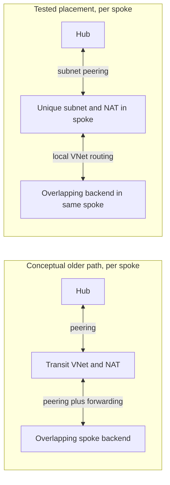
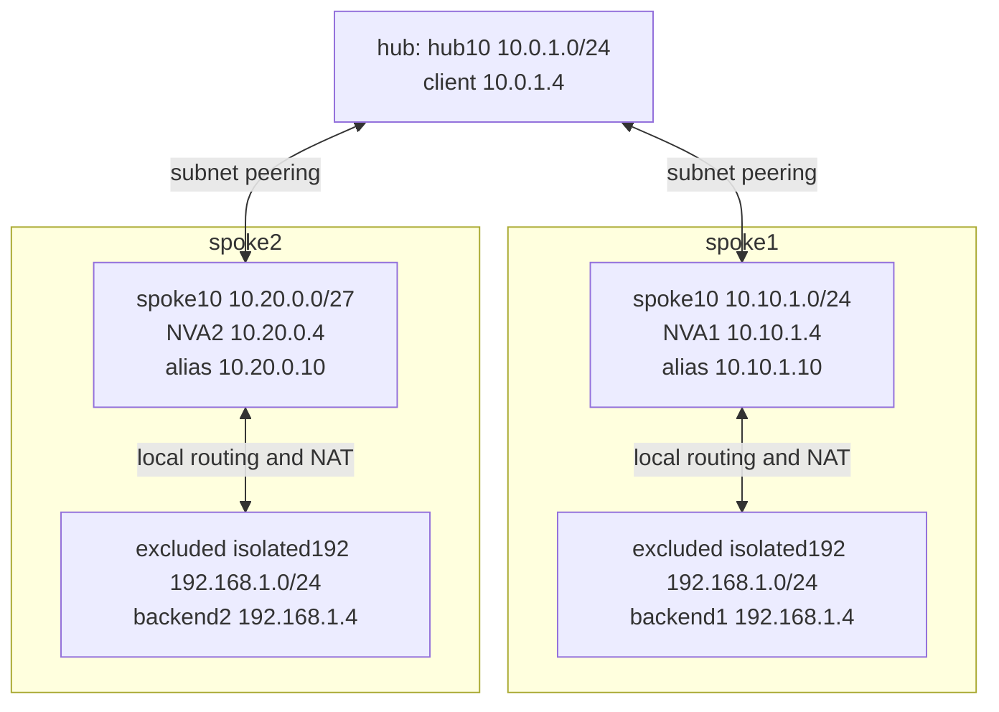

# Subnet peering: expose overlapping backends without extra transit VNets

Two applications can keep the same private IP without making your hub choose between them. With **subnet peering**, you can expose a unique NAT address in each spoke while leaving overlapping backend ranges out of the peering. The practical payoff is one less transit VNet layer to deploy, peer, and troubleshoot. NAT still does the translation; subnet peering lets you put it directly in the spoke that owns the backend.

In a Sweden Central lab on **16 October 2026**, a hub reached two distinct Azure VMs, both really using `192.168.1.4`, through aliases `10.10.1.10` and `10.20.0.10`. Each returned its own exact HTTP response three times. There were **three VNets, two NAT appliances, and no user-defined routes (UDRs)**. This is a tested HTTP design, not a claim that subnet peering makes overlapping destinations directly routable.

## Remove the transit layer, not the NAT

A conventional workaround places a non-overlapping transit VNet in front of each overlapping spoke. Translation and explicit forwarding make that path work; VNet peering is not inherently transitive. Subnet peering offers a different placement: select only the spoke's unique frontend subnet, and keep its overlapping backend subnet out.

The comparison below is conceptual. The older pattern was **not deployed or benchmarked** in this experiment. Notice the removed peering traversal, not an imagined removal of the translation appliance.



The distinction matters for brownfield estates. You need not renumber every backend, but you **do** need a unique address space for each participating frontend subnet. Microsoft Learn requires participating subnets **and their parent address spaces** to be unique across peering links. Selecting different subnets from the same overlapping parent space is not a loophole.

## The actual topology

Only the three 10.x subnets below participated. Both `192.168.1.0/24` backend subnets were excluded, despite their parent `192.168.0.0/16` appearing in both spokes.

| VNet | Complete address spaces | Selected subnet |
|---|---|---|
| hub | `10.0.0.0/16` | hub10: `10.0.1.0/24` |
| spoke1 | `10.10.0.0/16`, `192.168.0.0/16` | spoke10: `10.10.1.0/24` |
| spoke2 | `10.20.0.0/26`, `192.168.0.0/16` | spoke10: `10.20.0.0/27` |

Spoke2 really has a **/26 parent and /27 selected subnet**, not another /16. Here is the final topology, with the backend placement made explicit:



Each network virtual appliance (NVA) has one NIC. Its alias is a secondary Azure NIC IP configuration and is also configured in Linux, including a `/32` guest alias. Azure NIC IP forwarding and Linux IP forwarding are enabled. No spoke-to-spoke peering exists.

All four directed peering objects use `peerCompleteVnets=false`, `allowVirtualNetworkAccess=true`, and subnet **names**, not prefixes. Hub-side selectors are `localSubnetNames=["hub10"]`, `remoteSubnetNames=["spoke10"]`; reverse objects swap the lists. [Complete peering configuration](evidence/nat-evidence-20261016T085133Z/after-vnet-hub.json) preserves the actual API shape.

## Why no UDR is needed

The hub sends to an address **owned by the NVA**, not to the overlapping backend. Its existing peering route already reaches that alias. Destination NAT (DNAT) then changes the destination to the backend inside the NVA's own VNet. Source NAT (SNAT) changes the source to that NVA's primary address, making the backend reply locally through the same appliance.

For spoke1, the request and response are:

```text
Across peering:  10.0.1.4 -> 10.10.1.10:8080
After NAT:      10.10.1.4 -> 192.168.1.4:8080
Backend reply:  192.168.1.4:8080 -> 10.10.1.4
Reverse NAT:    10.10.1.10:8080 -> 10.0.1.4
```

The live rules below are excerpted from [NVA1's complete guest capture](evidence/nat-evidence-20261016T085133Z/before-vm-spoke1-spoke10.json), without counters. They are source-constrained to hub client `10.0.1.4`; this is not a validated service for every client or protocol.

```text
-A PREROUTING -s 10.0.1.4/32 -d 10.10.1.10/32 -j DNAT --to-destination 192.168.1.4
-A POSTROUTING -s 10.0.1.4/32 -d 192.168.1.4/32 -j SNAT --to-source 10.10.1.4
```

Connection tracking reverses both translations for the response. SNAT also means the backend sees the NVA, not the original hub client, a logging and policy tradeoff.

Interestingly, `allowForwardedTraffic=false` stayed unchanged on the peerings. This worked because the hub-facing endpoint is the NVA's own alias, with reverse-translated replies returning from that alias. It is **not** evidence that transparent transit works with forwarded traffic disabled. NIC and operating-system forwarding remain necessary for the NVA's local forwarding leg.

## Proof beyond a Connected peering

The fresh capture ran from **08:51:33 to 08:59:24 UTC**. Azure NIC assignments, guest addresses, and Azure VM IDs matched against guest Instance Metadata Service identities establish that these are **two different VMs with the same IP**, not two labels for one server.

These are the actual `ip -br -4 addr` lines from the [spoke1 backend](evidence/nat-evidence-20261016T085133Z/before-vm-spoke1-isolated192.json) and [spoke2 backend](evidence/nat-evidence-20261016T085133Z/before-vm-spoke2-isolated192.json) captures, respectively (VM labels added):

```text
# vm-spoke1-isolated192
eth0             UP             192.168.1.4/24 metric 100

# vm-spoke2-isolated192
eth0             UP             192.168.1.4/24 metric 100
```

At 08:56:11 UTC, the [hub capture](evidence/nat-evidence-20261016T085133Z/hub-vm-hub-hub10.json) recorded:

```text
Destination          HTTP successes   Exact body (each ends with newline)
10.10.1.10:8080       3/3              spoke1-backend-192.168.1.4
10.20.0.10:8080       3/3              spoke2-backend-192.168.1.4
```

For a closer look, these selected JSON fields preserve one actual response per alias from the [verification report](evidence/nat-evidence-20261016T085133Z/verification.json):

```json
[
  {
    "host": "10.10.1.10",
    "status": 200,
    "body": "spoke1-backend-192.168.1.4\n"
  },
  {
    "host": "10.20.0.10",
    "status": 200,
    "body": "spoke2-backend-192.168.1.4\n"
  }
]
```

Those results line up with independent evidence:

- On **each** NVA, DNAT and SNAT counters increased by **3** each. Request and established/reply FORWARD counters increased by **15** each. NAT counters count initial connection processing, not every forwarded packet.
- Backend HTTP logs show sources `10.10.1.4` and `10.20.0.4`, respectively, corroborating SNAT.
- Before/after VNet configurations and all five effective-route tables were unchanged.

The [verification report](evidence/nat-evidence-20261016T085133Z/verification.json) links every claim to its underlying captures. A direct HTTP request to `192.168.1.4:8080` timed out after three seconds, a bounded negative control, not an all-protocol isolation test.

### Routes explain the boundary

These selected entries come from the [hub's full effective-route table](evidence/nat-evidence-20261016T085133Z/routes-after-vm-hub-hub10.json). Each is Active with source Default:

| Prefix | Next-hop type | Meaning here |
|---|---|---|
| `10.10.1.0/24` | `VNetPeering` | Reaches spoke1's alias |
| `10.20.0.0/27` | `VNetPeering` | Reaches spoke2's alias |
| `192.168.0.0/16` | `None` | Best match for the overlapping backend |

Among spoke prefixes, the hub learns only the selected 10.x subnets. It never needs a route that distinguishes the two copies of `192.168.1.4`.

There is a subtle trap: **both excluded backend NICs still show a hub `10.0.1.0/24` peering route**. Learn documents forward-route visibility on nonpeered subnets in the current flagged release and warns that packets can still be dropped. Route visibility is not connectivity. The subnet name `isolated192` is not a security boundary, and NAT is not a production firewall approval.

## Does this save peering costs?

Potentially, by avoiding an **extra billable peering traversal**, not by deleting a fixed-price peering link.

[Azure's pricing model](https://azure.microsoft.com/en-us/pricing/details/virtual-network/) charges peering ingress and egress data transfer at both ends. A conceptual hub-to-transit-to-spoke request crosses two peering boundaries; this direct hub-to-spoke request crosses one, with translation and backend access inside the spoke. Apply that comparison to responses too.

Actual savings depend on traffic volume, direction, region, and the previous path. We did not measure billing or deploy the older design, so there is no defensible blanket “50% cheaper” claim. The two NVAs still cost money and require a high-availability design. The retained five-VM lab was estimated at approximately **$10.71/day for compute and disks**, not measured billing; all five VMs were left running.

## Before adopting it

Microsoft Learn, retrieved **16 October 2026**, still says subscription allowlisting is required, the feature is available in all regions, and configuration is through Terraform, PowerShell, API, CLI, or ARM templates. It also explicitly warns:

> “The participating subnets must be unique and must belong to unique address spaces across all peering links.”

Its production hardware warning names Intel V5, AMD Genoa, or Cobalt 100 based SKUs to avoid an older-generation bug. This lab used **Standard_D2als_v6**, an AMD Genoa generation. Recheck the [current limitations](https://learn.microsoft.com/en-us/azure/virtual-network/how-to-configure-subnet-peering#subnet-peering-checks-and-limitations), including peering-type replacement and delegated-subnet over-advertisement, before designing around it.

This experiment proves the source-constrained TCP 8080 HTTP path. It does not validate other ports, performance, NVA failover, or reboot recovery. Persistent systemd NAT configuration was captured, but no reboot was tested. Connection-tracking table inspection was unavailable and packet capture was omitted.

**The design takeaway:** keep duplicate backend addresses local, give each spoke a unique translated frontend, and use subnet peering to avoid building another VNet layer just to make that frontend reachable.

For troubleshooting or future experiments, the [archive guide](evidence/README.md) navigates the complete **78-file capture**, including all routes, NICs, guest configuration, logs, and checksums. [References and artifact map](references.md) keep the supporting detail outside the main story.
