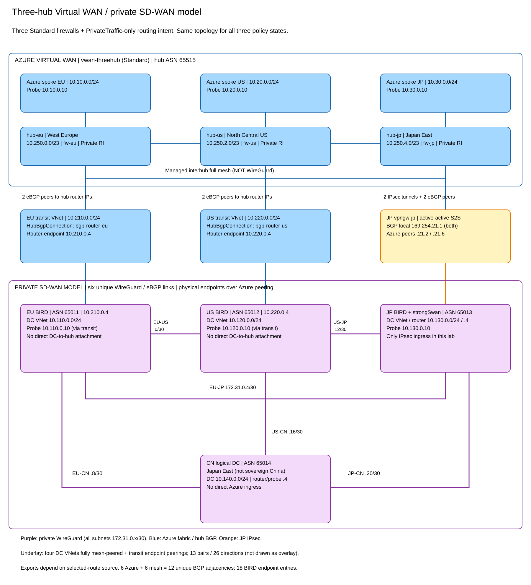

# Microsoft or customer backbone? Three Virtual WAN routing designs tested

**A prefers Microsoft's backbone; B1 and B2 prefer the customer backbone.** Azure's hub exit selection and the NVA's onward selection must agree. This rerun enables branch-to-branch at WAN level and on all three hubs and measures both routes and workload forwarding.

**19 October follow-up: B1 now passes all four corrected-workload reset controls.** ExpressRoute and VPN HRP each select the expected longer local Japan paths after resetting all six Azure-facing BGP sessions, whether Japan or EU/US reconnect first. All twelve DC-prefix firewall winners agree across orders within each HRP mode; every run passes 24/24 TCP and ICMP directions. This supports a **tested operational reset caveat**, rather than a B1 scenario blocker, within the measured conditions. It is not a universal determinism guarantee or proof that every HRP update needs a reset.

The matched mixed-setting and all-enabled baselines have identical DC-prefix firewall winners and **0 changed traffic outcomes out of 24 DC/Azure directional cells**. WAN-level B2B was already enabled; only Japan's hub flag changes from false to true. Original NVA sources, metadata, HRPs and PrivateTraffic routing intent are held constant. This isolates the flag for the baseline; it does not prove that the flag is irrelevant for every route history or supported topology.

**The B1 history dependency also reproduces with B2B enabled on every hub.** Under ExpressRoute HRP, EU/US initially retain remote Japan length three. Withdrawing only Japan's direct export selects local length-five paths; returning the export leaves those longer local paths selected. The separate EU length-four versus remote length-three control repeats the dependency. Source bytes/metadata and HRPs are identical between the initial and returned states. The mixed B2B flags therefore do not explain away that observation.

The following traffic counts describe the historical **17 October** captures; the updated B1 matched tables and reset controls appear below. Traffic and routing are separate findings. Acceptance covers only the **24 DC <-> Azure-spoke directions**, not DC-to-DC or auxiliary spoke-to-spoke traffic. B1's returned three-prepend state passes 10/24 TCP and 14/24 ICMP. VPN HRP selects longer local Japan paths in its measured state, with 14/24 TCP and 16/24 ICMP passes; that sequential control is not proof of a universal ER/VPN difference independent of route history. B2 without a workload UDR passes 18/24 for both: all six failures are Japan workload <-> Azure spoke directions. **A with its workload UDR passes 24/24 TCP and ICMP** and therefore meets the requested DC/Azure reachability criterion. Its historical DC-to-DC failures are outside that criterion. Reachability acceptance is not by itself proof that every packet used the intended backbone.

**The new reversible B2 control identifies the missing Japan workload subnet UDR.** With three spoke-prefix routes to `10.130.0.4`, B2 passes **24/24 TCP and ICMP**. Removing those routes restores 18/24. BIRD policy, NVA selections and firewall winners remain unchanged; the workload NIC changes from the system `10.0.0.0/8 -> None` drop route to the explicit NVA next hops.

## One topology, two possible backbones


The upper fabric is Azure Standard Virtual WAN: hubs in **West Europe, North Central US, and Japan East**, with one Standard Azure Firewall each. All three use **PrivateTraffic-only routing intent**, not Internet routing intent. The lower fabric is a full six-link WireGuard mesh between four Linux/BIRD routers, over a peered Azure VNet underlay. It models the customer inter-DC backbone; it is not the managed Azure interhub mesh.

BGP means Border Gateway Protocol, ASN identifies an autonomous system, NVA means network virtual appliance, and LP below is the explicit `BGP.local_pref` attribute. DC labels are synthetic on-premises networks modeled in Azure.

| Site | Router / ASN | Synthetic DC / probe | Azure spoke / probe | Virtual WAN attachment |
|---|---|---|---|---|
| EU | `10.210.0.4`, ASN `65011`, transit `10.210.0.0/24` | `10.110.0.0/24`, `.10` | `10.10.0.0/24`, `.10` | Ordinary peered-VNet `HubBgpConnection`, two eBGP peers |
| US | `10.220.0.4`, ASN `65012`, transit `10.220.0.0/24` | `10.120.0.0/24`, `.10` | `10.20.0.0/24`, `.10` | Ordinary peered-VNet `HubBgpConnection`, two eBGP peers |
| JP | `10.130.0.4`, ASN `65013` | `10.130.0.0/24`, `.10` | `10.30.0.0/24`, `.10` | Two strongSwan IPsec tunnels and two eBGP peers |
| CN | `10.140.0.4`, ASN `65014` | `10.140.0.0/24`, router `.4` also serves as probe | None | Customer mesh only |

EU/US are not integrated vendor SD-WAN VPN gateways. This describes their actual attachment, not a claim that a particular HRP mode is generally unsupported for NVAs. Japan's BGP local address is `169.254.21.1`; its Azure peers are `169.254.21.2` and `.6`, reached over `xfrm41` and `xfrm42`.

The logical CN site is hosted in Japan East, not sovereign China. It has **no direct Azure hub attachment** and must choose a mesh ingress. There is **no ExpressRoute circuit** in this lab: `ExpressRoute` is an HRP policy name. The hub ASN is `65515`; interhub advertisements add `65520 65520`.

Six unique mesh adjacencies plus six Azure-facing adjacencies make **12 unique BGP adjacencies**, represented by **18 BIRD endpoint entries** because each customer mesh link is configured at both ends.

## What the three designs configure

| Design | All-hub HRP | NVA policy |
|---|---|---|
| A: Microsoft | ASPath | Foreign DC/spoke Azure imports at LP 400; three nonlocal prepends on EU/US/JP; JP workload UDR needed for observed 24/24 reachability; policy-only control measured separately |
| B1: customer | ExpressRoute; VpnGateway measured separately | Spoke-only Azure imports; three extra nonlocal EU/US prepends; JP none |
| B2: customer | ASPath | Spoke-only Azure imports; zero extra EU/US/JP prepends; three-spoke JP workload UDR |

The [documented HRP ordering](https://learn.microsoft.com/en-us/azure/virtual-wan/about-virtual-hub-routing-preference) prioritizes locality under ExpressRoute/VPN and path length under ASPath. The B1 initial, withdrawn and returned states below expose the measured selection history rather than assuming every HRP update recomputes the same winner.

## Forwarding results, not just routing tables

| Measured state | TCP / 24 | ICMP / 24 | DC/Azure reachability |
|---|---|---|---|
| [Mixed baseline](https://github.com/erjosito/net-lab-builder/blob/main/labs/vwan-sdwan-three-hub/show-output/b2b-mixed-baseline-20261017/baseline/traffic-summary.json) | 10 | 14 | FAIL |
| [All B2B baseline](https://github.com/erjosito/net-lab-builder/blob/main/labs/vwan-sdwan-three-hub/show-output/b2b-enabled-baseline-20261017/baseline/traffic-summary.json) | 10 | 14 | FAIL |
| [A, NVA policy only](https://github.com/erjosito/net-lab-builder/blob/main/labs/vwan-sdwan-three-hub/show-output/b2b-A-20261017/A/traffic-summary.json) | 18 | 18 | FAIL |
| [A, plus JP workload UDR](https://github.com/erjosito/net-lab-builder/blob/main/labs/vwan-sdwan-three-hub/show-output/b2b-A-20261017/A-workload-UDR/traffic-summary.json) | 24 | 24 | PASS |
| [B1, ExpressRoute initial](https://github.com/erjosito/net-lab-builder/blob/main/labs/vwan-sdwan-three-hub/show-output/b2b-B1-20261017/B1/traffic-summary.json) | 10 | 14 | FAIL |
| [B1, JP direct prefix withdrawn](https://github.com/erjosito/net-lab-builder/blob/main/labs/vwan-sdwan-three-hub/show-output/b2b-B1-20261017/B1-withdrawn/traffic-summary.json) | 10 | 14 | FAIL |
| [B1, JP direct prefix returned](https://github.com/erjosito/net-lab-builder/blob/main/labs/vwan-sdwan-three-hub/show-output/b2b-B1-20261017/B1-returned/traffic-summary.json) | 10 | 14 | FAIL |
| [B1 one-ASN, initial](https://github.com/erjosito/net-lab-builder/blob/main/labs/vwan-sdwan-three-hub/show-output/b2b-B1-one-ASN-20261017/B1-one-ASN/traffic-summary.json) | 12 | 15 | FAIL |
| [B1 one-ASN, withdrawn](https://github.com/erjosito/net-lab-builder/blob/main/labs/vwan-sdwan-three-hub/show-output/b2b-B1-one-ASN-20261017/B1-one-ASN-withdrawn/traffic-summary.json) | 12 | 15 | FAIL |
| [B1 one-ASN, returned](https://github.com/erjosito/net-lab-builder/blob/main/labs/vwan-sdwan-three-hub/show-output/b2b-B1-one-ASN-20261017/B1-one-ASN-returned/traffic-summary.json) | 12 | 15 | FAIL |
| [B1, VPN HRP](https://github.com/erjosito/net-lab-builder/blob/main/labs/vwan-sdwan-three-hub/show-output/b2b-B1-VPN-20261017/B1-VPN/traffic-summary.json) | 14 | 16 | FAIL |
| [B2, zero extra EU/US prepends](https://github.com/erjosito/net-lab-builder/blob/main/labs/vwan-sdwan-three-hub/show-output/b2b-B2-20261017/B2/traffic-summary.json) | 18 | 18 | FAIL |
| [B2, before workload UDR](https://github.com/erjosito/net-lab-builder/blob/main/labs/vwan-sdwan-three-hub/show-output/b2-diagnosis-control-20261017/B2-before/traffic-summary.json) | 18 | 18 | FAIL |
| [B2, three-spoke workload UDR](https://github.com/erjosito/net-lab-builder/blob/main/labs/vwan-sdwan-three-hub/show-output/b2-diagnosis-control-20261017/B2-with-UDR/traffic-summary.json) | 24 | 24 | PASS |
| [B2, workload UDR removed again](https://github.com/erjosito/net-lab-builder/blob/main/labs/vwan-sdwan-three-hub/show-output/b2-diagnosis-control-20261017/B2-reverted/traffic-summary.json) | 18 | 18 | FAIL |

Every measured state has full firewall effective tables for all three hubs, paired stable DC-prefix winners at least 120 seconds apart, full BIRD sources and selected/alternative routes on all four routers. The historical rerun has an explicitly sourced 42-direction TCP/ICMP matrix; the new B2 steering control sends only the 24 requested DC/Azure directions. The seven endpoints are four synthetic DCs and three Azure spokes: 12 DC-to-DC, 24 DC/spoke and six spoke-to-spoke directions. **Only the 24 DC/Azure directions determine acceptance.** The twelve DC-to-DC directions are excluded, and the six spoke-to-spoke directions are auxiliary. The raw 42-cell files and their original verdicts remain unchanged; `acceptance.csv` and the tables below derive the requested scope explicitly. TCP requires HTTP 200 on the private port 5201 listener and matching local/remote addresses; ICMP uses source-bound ping. P/F below means TCP PASS / ICMP FAIL.

Bounded tcpdump captures on every router observe inner test packets on physical, WireGuard and XFRM interfaces; management traffic and encrypted transport payloads are not collected. The interface observations are not a throughput measurement or a complete symmetry proof. Failed SYNs/ICMP attempts can still appear in a capture. The peered underlay and workload routing must be considered rather than treating an HTTP success as proof of Microsoft interhub transit. `!` in a BIRD table is a kernel-export warning; inspect Linux routes and actual packets rather than assuming the route is absent or blaming a traffic failure on this marker alone. A collector verdict of PASS means complete measurements and exact configuration closure, not 42 successful traffic directions.

During B1's three-prepend withdrawal, Japan's firewall exposes two equal-length remote Japan-prefix entries, one through EU and one through US. All twelve hub/prefix keys remain present, but there are thirteen rows. The inherited single-winner check therefore records `complete: false`; this flag is retained in raw evidence and does not mean a prefix was missing in that state.

## How to read the captured tables

Each design below contains the full EU and Japan firewall table, not a filtered supporting prefix. US is collected too and available in the matched evidence. EU, Japan and CN NVA tables include all seven DC/spoke prefixes. BGP next hop and BIRD resolution are distinct attributes. `n/a` means absent on a static route; `empty` means a blank firewall AS path. The primary A state includes the workload UDR; primary B1 is the 19 October ExpressRoute / Japan-first reset capture.

## A: Microsoft backbone preferred

All hubs use `ASPath`. The three Azure-facing NVAs accept foreign DC and spoke routes from Azure at LP 400. EU/US/JP add three extra own-AS copies for nonlocal DC exports. The export source guard prevents feeding an Azure-learned best route back into Azure. CN remains mesh-only, so this is not an all-prefix Microsoft-only design.

The primary capture includes the five-prefix Japan workload UDR to `10.130.0.4`; the policy-only control is measured separately. The UDR covers EU/US DCs and all three Azure spokes, not CN's transport endpoint.

Matched state: [A, plus JP workload UDR](https://github.com/erjosito/net-lab-builder/blob/main/labs/vwan-sdwan-three-hub/show-output/b2b-A-20261017/A-workload-UDR/scenario-result.json). Full BIRD configurations: [EU](https://github.com/erjosito/net-lab-builder/blob/main/labs/vwan-sdwan-three-hub/show-output/b2b-A-20261017/A-workload-UDR/router-eu.conf), [US](https://github.com/erjosito/net-lab-builder/blob/main/labs/vwan-sdwan-three-hub/show-output/b2b-A-20261017/A-workload-UDR/router-us.conf), [JP](https://github.com/erjosito/net-lab-builder/blob/main/labs/vwan-sdwan-three-hub/show-output/b2b-A-20261017/A-workload-UDR/router-jp.conf), [CN](https://github.com/erjosito/net-lab-builder/blob/main/labs/vwan-sdwan-three-hub/show-output/b2b-A-20261017/A-workload-UDR/router-cn.conf).

### A: complete EU firewall table

| Prefix | ASPath | NextHopType |
|---|---|---|
| `10.210.0.0/24` | empty | Virtual Network Connection |
| `10.10.0.0/24` | empty | Virtual Network Connection |
| `10.110.0.0/24` | `65011` | HubBgpConnection |
| `10.140.0.0/24` | `65011-65011-65011-65011-65014` | HubBgpConnection |
| `10.130.0.0/24` | `65520-65520-65013` | Remote Hub |
| `10.30.0.0/24` | `65520-65520` | Remote Hub |
| `10.220.0.0/24` | `65520-65520` | Remote Hub |
| `10.120.0.0/24` | `65520-65520-65012` | Remote Hub |
| `10.20.0.0/24` | `65520-65520` | Remote Hub |
| `0.0.0.0/0` | empty | Internet |

### A: complete JP firewall table

| Prefix | ASPath | NextHopType |
|---|---|---|
| `10.140.0.0/24` | `65013-65013-65013-65013-65014` | VPN_S2S_Gateway |
| `10.130.0.0/24` | `65013` | VPN_S2S_Gateway |
| `10.10.0.0/24` | `65520-65520` | Remote Hub |
| `10.220.0.0/24` | `65520-65520` | Remote Hub |
| `10.120.0.0/24` | `65520-65520-65012` | Remote Hub |
| `10.20.0.0/24` | `65520-65520` | Remote Hub |
| `10.210.0.0/24` | `65520-65520` | Remote Hub |
| `10.110.0.0/24` | `65520-65520-65011` | Remote Hub |
| `10.30.0.0/24` | empty | Virtual Network Connection |
| `0.0.0.0/0` | empty | Internet |

### A: EU selected NVA routes

| Prefix | Protocol | BGP next hop | BIRD resolution | ASPath | LP | Marker |
|---|---|---|---|---|---|---|
| `10.110.0.0/24` | `own_dc` | `n/a` | `via 10.210.0.1 on eth0` | `n/a` | n/a | `*` |
| `10.120.0.0/24` | `azure_0` | `10.210.0.1` | `via 10.210.0.1 on eth0` | `65515 65520 65520 65012` | 400 | `*` |
| `10.130.0.0/24` | `azure_0` | `10.210.0.1` | `via 10.210.0.1 on eth0` | `65515 65520 65520 65013` | 400 | `*` |
| `10.140.0.0/24` | `mesh_cn` | `172.31.0.10` | `dev wgeucn` | `65014` | 100 | `*` |
| `10.10.0.0/24` | `azure_0` | `10.210.0.1` | `via 10.210.0.1 on eth0` | `65515` | 400 | `*` |
| `10.20.0.0/24` | `azure_0` | `10.210.0.1` | `via 10.210.0.1 on eth0` | `65515 65520 65520` | 400 | `*` |
| `10.30.0.0/24` | `azure_0` | `10.210.0.1` | `via 10.210.0.1 on eth0` | `65515 65520 65520` | 400 | `*` |

### A: JP selected NVA routes

| Prefix | Protocol | BGP next hop | BIRD resolution | ASPath | LP | Marker |
|---|---|---|---|---|---|---|
| `10.110.0.0/24` | `azure_1` | `169.254.21.6` | `via 169.254.21.6 on xfrm42` | `65515 65520 65520 65011` | 400 | `!` |
| `10.120.0.0/24` | `azure_1` | `169.254.21.6` | `via 169.254.21.6 on xfrm42` | `65515 65520 65520 65012` | 400 | `!` |
| `10.130.0.0/24` | `own_dc` | `n/a` | `dev eth0` | `n/a` | n/a | `*` |
| `10.140.0.0/24` | `mesh_cn` | `172.31.0.22` | `dev wgjpcn` | `65014` | 100 | `*` |
| `10.10.0.0/24` | `azure_1` | `169.254.21.6` | `via 169.254.21.6 on xfrm42` | `65515 65520 65520` | 400 | `!` |
| `10.20.0.0/24` | `azure_1` | `169.254.21.6` | `via 169.254.21.6 on xfrm42` | `65515 65520 65520` | 400 | `!` |
| `10.30.0.0/24` | `azure_1` | `169.254.21.6` | `via 169.254.21.6 on xfrm42` | `65515` | 400 | `!` |

### A: CN selected NVA routes

| Prefix | Protocol | BGP next hop | BIRD resolution | ASPath | LP | Marker |
|---|---|---|---|---|---|---|
| `10.110.0.0/24` | `mesh_eu` | `172.31.0.9` | `dev wgeucn` | `65011` | 100 | `*` |
| `10.120.0.0/24` | `mesh_us` | `172.31.0.17` | `dev wguscn` | `65012` | 100 | `*` |
| `10.130.0.0/24` | `mesh_jp` | `172.31.0.21` | `dev wgjpcn` | `65013` | 100 | `*` |
| `10.140.0.0/24` | `own_dc` | `n/a` | `dev eth0` | `n/a` | n/a | `*` |
| `10.10.0.0/24` | `mesh_eu` | `172.31.0.9` | `dev wgeucn` | `65011 65515` | 300 | `*` |
| `10.20.0.0/24` | `mesh_us` | `172.31.0.17` | `dev wguscn` | `65012 65515` | 300 | `*` |
| `10.30.0.0/24` | `mesh_jp` | `172.31.0.21` | `dev wgjpcn` | `65013 65515` | 300 | `*` |

### A: captured EU export policy

```bird
filter azure_export {
  if net ~ [10.110.0.0/24, 10.120.0.0/24, 10.130.0.0/24, 10.140.0.0/24] &&
     (proto = "own_dc" || proto ~ "mesh_*") then {
        if net != 10.110.0.0/24 then {
            bgp_path.prepend(65011);
            bgp_path.prepend(65011);
            bgp_path.prepend(65011);
        }
        accept;
  }
  reject;
}
```

### A: 24 DC/Azure acceptance directions

**DC -> Azure spoke**

| DC / Azure spoke | spoke-eu | spoke-us | spoke-jp |
|---|---|---|---|
| dc-eu | P/P | P/P | P/P |
| dc-us | P/P | P/P | P/P |
| dc-jp | P/P | P/P | P/P |
| cn | P/P | P/P | P/P |

**Azure spoke -> DC**

| DC / Azure spoke | spoke-eu | spoke-us | spoke-jp |
|---|---|---|---|
| dc-eu | P/P | P/P | P/P |
| dc-us | P/P | P/P | P/P |
| dc-jp | P/P | P/P | P/P |
| cn | P/P | P/P | P/P |

## B1: Customer backbone through HRP

The primary capture now uses the **19 October ExpressRoute / Japan-first BGP reset** with the original three extra EU/US nonlocal prepends, no extra Japan prepends, and spoke-only Azure imports. All hub branch flags are enabled and the Japan workload subnet has its three-spoke UDR through `10.130.0.4`. No BIRD configuration, mesh session or IPsec tunnel is restarted or changed during the reset.

The 17 October withdrawal/return captures and their original lower traffic counts remain in the historical results below. The new reset section compares both HRP modes and both establishment orders. A post-reset local winner does not prove that every HRP update requires a reset, or guarantee selection after every future reconvergence.

Matched state: [ExpressRoute, japan-first](https://github.com/erjosito/net-lab-builder/blob/main/labs/vwan-sdwan-three-hub/show-output/hrp-reset-expressroute-japan-first-20261019/after-reset/scenario-result.json). Full BIRD configurations: [EU](https://github.com/erjosito/net-lab-builder/blob/main/labs/vwan-sdwan-three-hub/show-output/hrp-reset-expressroute-japan-first-20261019/after-reset/router-eu.conf), [US](https://github.com/erjosito/net-lab-builder/blob/main/labs/vwan-sdwan-three-hub/show-output/hrp-reset-expressroute-japan-first-20261019/after-reset/router-us.conf), [JP](https://github.com/erjosito/net-lab-builder/blob/main/labs/vwan-sdwan-three-hub/show-output/hrp-reset-expressroute-japan-first-20261019/after-reset/router-jp.conf), [CN](https://github.com/erjosito/net-lab-builder/blob/main/labs/vwan-sdwan-three-hub/show-output/hrp-reset-expressroute-japan-first-20261019/after-reset/router-cn.conf).

### B1: complete EU firewall table

| Prefix | ASPath | NextHopType |
|---|---|---|
| `10.210.0.0/24` | empty | Virtual Network Connection |
| `10.10.0.0/24` | empty | Virtual Network Connection |
| `10.130.0.0/24` | `65011-65011-65011-65011-65013` | HubBgpConnection |
| `10.120.0.0/24` | `65011-65011-65011-65011-65012` | HubBgpConnection |
| `10.140.0.0/24` | `65011-65011-65011-65011-65014` | HubBgpConnection |
| `10.110.0.0/24` | `65011` | HubBgpConnection |
| `10.30.0.0/24` | `65520-65520` | Remote Hub |
| `10.220.0.0/24` | `65520-65520` | Remote Hub |
| `10.20.0.0/24` | `65520-65520` | Remote Hub |
| `0.0.0.0/0` | empty | Internet |

### B1: complete JP firewall table

| Prefix | ASPath | NextHopType |
|---|---|---|
| `10.120.0.0/24` | `65013-65012` | VPN_S2S_Gateway |
| `10.130.0.0/24` | `65013` | VPN_S2S_Gateway |
| `10.140.0.0/24` | `65013-65014` | VPN_S2S_Gateway |
| `10.110.0.0/24` | `65013-65011` | VPN_S2S_Gateway |
| `10.30.0.0/24` | empty | Virtual Network Connection |
| `10.10.0.0/24` | `65520-65520` | Remote Hub |
| `10.220.0.0/24` | `65520-65520` | Remote Hub |
| `10.20.0.0/24` | `65520-65520` | Remote Hub |
| `10.210.0.0/24` | `65520-65520` | Remote Hub |
| `0.0.0.0/0` | empty | Internet |

### B1: EU selected NVA routes

| Prefix | Protocol | BGP next hop | BIRD resolution | ASPath | LP | Marker |
|---|---|---|---|---|---|---|
| `10.110.0.0/24` | `own_dc` | `n/a` | `via 10.210.0.1 on eth0` | `n/a` | n/a | `*` |
| `10.120.0.0/24` | `mesh_us` | `172.31.0.2` | `dev wgeuus` | `65012` | 100 | `*` |
| `10.130.0.0/24` | `mesh_jp` | `172.31.0.6` | `dev wgeujp` | `65013` | 100 | `*` |
| `10.140.0.0/24` | `mesh_cn` | `172.31.0.10` | `dev wgeucn` | `65014` | 100 | `*` |
| `10.10.0.0/24` | `azure_0` | `10.210.0.1` | `via 10.210.0.1 on eth0` | `65515` | 300 | `*` |
| `10.20.0.0/24` | `mesh_us` | `172.31.0.2` | `dev wgeuus` | `65012 65515` | 300 | `*` |
| `10.30.0.0/24` | `mesh_jp` | `172.31.0.6` | `dev wgeujp` | `65013 65515` | 300 | `*` |

### B1: JP selected NVA routes

| Prefix | Protocol | BGP next hop | BIRD resolution | ASPath | LP | Marker |
|---|---|---|---|---|---|---|
| `10.110.0.0/24` | `mesh_eu` | `172.31.0.5` | `dev wgeujp` | `65011` | 100 | `*` |
| `10.120.0.0/24` | `mesh_us` | `172.31.0.13` | `dev wgusjp` | `65012` | 100 | `*` |
| `10.130.0.0/24` | `own_dc` | `n/a` | `dev eth0` | `n/a` | n/a | `*` |
| `10.140.0.0/24` | `mesh_cn` | `172.31.0.22` | `dev wgjpcn` | `65014` | 100 | `*` |
| `10.10.0.0/24` | `mesh_eu` | `172.31.0.5` | `dev wgeujp` | `65011 65515` | 300 | `*` |
| `10.20.0.0/24` | `mesh_us` | `172.31.0.13` | `dev wgusjp` | `65012 65515` | 300 | `*` |
| `10.30.0.0/24` | `azure_1` | `169.254.21.6` | `via 169.254.21.6 on xfrm42` | `65515` | 300 | `!` |

### B1: CN selected NVA routes

| Prefix | Protocol | BGP next hop | BIRD resolution | ASPath | LP | Marker |
|---|---|---|---|---|---|---|
| `10.110.0.0/24` | `mesh_eu` | `172.31.0.9` | `dev wgeucn` | `65011` | 100 | `*` |
| `10.120.0.0/24` | `mesh_us` | `172.31.0.17` | `dev wguscn` | `65012` | 100 | `*` |
| `10.130.0.0/24` | `mesh_jp` | `172.31.0.21` | `dev wgjpcn` | `65013` | 100 | `*` |
| `10.140.0.0/24` | `own_dc` | `n/a` | `dev eth0` | `n/a` | n/a | `*` |
| `10.10.0.0/24` | `mesh_eu` | `172.31.0.9` | `dev wgeucn` | `65011 65515` | 300 | `*` |
| `10.20.0.0/24` | `mesh_us` | `172.31.0.17` | `dev wguscn` | `65012 65515` | 300 | `*` |
| `10.30.0.0/24` | `mesh_jp` | `172.31.0.21` | `dev wgjpcn` | `65013 65515` | 300 | `*` |

### B1: captured EU export policy

```bird
filter azure_export {
  if net ~ [10.110.0.0/24, 10.120.0.0/24, 10.130.0.0/24, 10.140.0.0/24] &&
     (proto = "own_dc" || proto ~ "mesh_*") then {
        if net != 10.110.0.0/24 then {
            bgp_path.prepend(65011);
            bgp_path.prepend(65011);
            bgp_path.prepend(65011);
        }
        accept;
  }
  reject;
}
```

### B1: 24 DC/Azure acceptance directions

**DC -> Azure spoke**

| DC / Azure spoke | spoke-eu | spoke-us | spoke-jp |
|---|---|---|---|
| dc-eu | P/P | P/P | P/P |
| dc-us | P/P | P/P | P/P |
| dc-jp | P/P | P/P | P/P |
| cn | P/P | P/P | P/P |

**Azure spoke -> DC**

| DC / Azure spoke | spoke-eu | spoke-us | spoke-jp |
|---|---|---|---|
| dc-eu | P/P | P/P | P/P |
| dc-us | P/P | P/P | P/P |
| dc-jp | P/P | P/P | P/P |
| cn | P/P | P/P | P/P |

## B2: Customer backbone through AS-path control

All hubs use `ASPath`. EU/US nonlocal extra prepends are removed; Japan still has no extra prepends. Azure imports remain spoke-only, so NVAs keep foreign DCs on their mesh. Removing prepends shortens the local offer; this is not a claim that adding prepends everywhere favors the customer backbone.

The primary capture now includes the three-spoke Japan workload UDR to `10.130.0.4` and passes 24/24 DC/Azure directions. The no-UDR and UDR-removal controls below isolate the previous six failures without changing BGP policy.

Matched state: [B2, three-spoke workload UDR](https://github.com/erjosito/net-lab-builder/blob/main/labs/vwan-sdwan-three-hub/show-output/b2-diagnosis-control-20261017/B2-with-UDR/scenario-result.json). Full BIRD configurations: [EU](https://github.com/erjosito/net-lab-builder/blob/main/labs/vwan-sdwan-three-hub/show-output/b2-diagnosis-control-20261017/B2-with-UDR/router-eu.conf), [US](https://github.com/erjosito/net-lab-builder/blob/main/labs/vwan-sdwan-three-hub/show-output/b2-diagnosis-control-20261017/B2-with-UDR/router-us.conf), [JP](https://github.com/erjosito/net-lab-builder/blob/main/labs/vwan-sdwan-three-hub/show-output/b2-diagnosis-control-20261017/B2-with-UDR/router-jp.conf), [CN](https://github.com/erjosito/net-lab-builder/blob/main/labs/vwan-sdwan-three-hub/show-output/b2-diagnosis-control-20261017/B2-with-UDR/router-cn.conf).

### B2: complete EU firewall table

| Prefix | ASPath | NextHopType |
|---|---|---|
| `10.210.0.0/24` | empty | Virtual Network Connection |
| `10.10.0.0/24` | empty | Virtual Network Connection |
| `10.110.0.0/24` | `65011` | HubBgpConnection |
| `10.130.0.0/24` | `65011-65013` | HubBgpConnection |
| `10.120.0.0/24` | `65011-65012` | HubBgpConnection |
| `10.140.0.0/24` | `65011-65014` | HubBgpConnection |
| `10.30.0.0/24` | `65520-65520` | Remote Hub |
| `10.220.0.0/24` | `65520-65520` | Remote Hub |
| `10.20.0.0/24` | `65520-65520` | Remote Hub |
| `0.0.0.0/0` | empty | Internet |

### B2: complete JP firewall table

| Prefix | ASPath | NextHopType |
|---|---|---|
| `10.120.0.0/24` | `65013-65012` | VPN_S2S_Gateway |
| `10.140.0.0/24` | `65013-65014` | VPN_S2S_Gateway |
| `10.130.0.0/24` | `65013` | VPN_S2S_Gateway |
| `10.110.0.0/24` | `65013-65011` | VPN_S2S_Gateway |
| `10.10.0.0/24` | `65520-65520` | Remote Hub |
| `10.220.0.0/24` | `65520-65520` | Remote Hub |
| `10.20.0.0/24` | `65520-65520` | Remote Hub |
| `10.210.0.0/24` | `65520-65520` | Remote Hub |
| `10.30.0.0/24` | empty | Virtual Network Connection |
| `0.0.0.0/0` | empty | Internet |

### B2: EU selected NVA routes

| Prefix | Protocol | BGP next hop | BIRD resolution | ASPath | LP | Marker |
|---|---|---|---|---|---|---|
| `10.110.0.0/24` | `own_dc` | `n/a` | `via 10.210.0.1 on eth0` | `n/a` | n/a | `*` |
| `10.120.0.0/24` | `mesh_us` | `172.31.0.2` | `dev wgeuus` | `65012` | 100 | `*` |
| `10.130.0.0/24` | `mesh_jp` | `172.31.0.6` | `dev wgeujp` | `65013` | 100 | `*` |
| `10.140.0.0/24` | `mesh_cn` | `172.31.0.10` | `dev wgeucn` | `65014` | 100 | `*` |
| `10.10.0.0/24` | `azure_0` | `10.210.0.1` | `via 10.210.0.1 on eth0` | `65515` | 300 | `*` |
| `10.20.0.0/24` | `mesh_us` | `172.31.0.2` | `dev wgeuus` | `65012 65515` | 300 | `*` |
| `10.30.0.0/24` | `mesh_jp` | `172.31.0.6` | `dev wgeujp` | `65013 65515` | 300 | `*` |

### B2: JP selected NVA routes

| Prefix | Protocol | BGP next hop | BIRD resolution | ASPath | LP | Marker |
|---|---|---|---|---|---|---|
| `10.110.0.0/24` | `mesh_eu` | `172.31.0.5` | `dev wgeujp` | `65011` | 100 | `*` |
| `10.120.0.0/24` | `mesh_us` | `172.31.0.13` | `dev wgusjp` | `65012` | 100 | `*` |
| `10.130.0.0/24` | `own_dc` | `n/a` | `dev eth0` | `n/a` | n/a | `*` |
| `10.140.0.0/24` | `mesh_cn` | `172.31.0.22` | `dev wgjpcn` | `65014` | 100 | `*` |
| `10.10.0.0/24` | `mesh_eu` | `172.31.0.5` | `dev wgeujp` | `65011 65515` | 300 | `*` |
| `10.20.0.0/24` | `mesh_us` | `172.31.0.13` | `dev wgusjp` | `65012 65515` | 300 | `*` |
| `10.30.0.0/24` | `azure_1` | `169.254.21.6` | `via 169.254.21.6 on xfrm42` | `65515` | 300 | `!` |

### B2: CN selected NVA routes

| Prefix | Protocol | BGP next hop | BIRD resolution | ASPath | LP | Marker |
|---|---|---|---|---|---|---|
| `10.110.0.0/24` | `mesh_eu` | `172.31.0.9` | `dev wgeucn` | `65011` | 100 | `*` |
| `10.120.0.0/24` | `mesh_us` | `172.31.0.17` | `dev wguscn` | `65012` | 100 | `*` |
| `10.130.0.0/24` | `mesh_jp` | `172.31.0.21` | `dev wgjpcn` | `65013` | 100 | `*` |
| `10.140.0.0/24` | `own_dc` | `n/a` | `dev eth0` | `n/a` | n/a | `*` |
| `10.10.0.0/24` | `mesh_eu` | `172.31.0.9` | `dev wgeucn` | `65011 65515` | 300 | `*` |
| `10.20.0.0/24` | `mesh_us` | `172.31.0.17` | `dev wguscn` | `65012 65515` | 300 | `*` |
| `10.30.0.0/24` | `mesh_jp` | `172.31.0.21` | `dev wgjpcn` | `65013 65515` | 300 | `*` |

### B2: captured EU export policy

```bird
filter azure_export {
  if net ~ [10.110.0.0/24, 10.120.0.0/24, 10.130.0.0/24, 10.140.0.0/24] &&
     (proto = "own_dc" || proto ~ "mesh_*") then {
        accept;
  }
  reject;
}
```

### B2: 24 DC/Azure acceptance directions

**DC -> Azure spoke**

| DC / Azure spoke | spoke-eu | spoke-us | spoke-jp |
|---|---|---|---|
| dc-eu | P/P | P/P | P/P |
| dc-us | P/P | P/P | P/P |
| dc-jp | P/P | P/P | P/P |
| cn | P/P | P/P | P/P |

**Azure spoke -> DC**

| DC / Azure spoke | spoke-eu | spoke-us | spoke-jp |
|---|---|---|---|
| dc-eu | P/P | P/P | P/P |
| dc-us | P/P | P/P | P/P |
| dc-jp | P/P | P/P | P/P |
| cn | P/P | P/P | P/P |

## B1 initial selection and controlled route return

| State | EU Japan path | US Japan path |
|---|---|---|
| B1, ExpressRoute initial | `65520-65520-65013` (Remote Hub) | `65520-65520-65013` (Remote Hub) |
| B1, JP direct prefix withdrawn | `65011-65011-65011-65011-65013` (HubBgpConnection) | `65012-65012-65012-65012-65013` (HubBgpConnection) |
| B1, JP direct prefix returned | `65011-65011-65011-65011-65013` (HubBgpConnection) | `65012-65012-65012-65012-65013` (HubBgpConnection) |
| B1 one-ASN, initial | `65520-65520-65013` (Remote Hub) | `65012-65012-65012-65012-65013` (HubBgpConnection) |
| B1 one-ASN, withdrawn | `65011-65011-65011-65013` (HubBgpConnection) | `65012-65012-65012-65012-65013` (HubBgpConnection) |
| B1 one-ASN, returned | `65011-65011-65011-65013` (HubBgpConnection) | `65012-65012-65012-65012-65013` (HubBgpConnection) |
| B1, VPN HRP | `65011-65011-65011-65011-65013` (HubBgpConnection) | `65012-65012-65012-65012-65013` (HubBgpConnection) |

### Start with one destination and two ways to reach it

Consider an Azure VM in the EU spoke sending to the Japan DC workload, `10.130.0.10`.
A **prefix** is a range of addresses: the route for `10.130.0.0/24` covers this workload.
The EU hub can learn two BGP routes for that same prefix. They deliver packets to the same
destination, but enter the on-premises network at different places:

| Candidate at the EU hub | Where Azure learns it | Onward forwarding | AS path seen by the EU firewall | Length |
|---|---|---|---|---|
| Local | EU NVA's BGP connection to the EU hub | EU NVA -> customer mesh -> Japan NVA -> Japan workload | `65011 65011 65011 65011 65013` | 5 |
| Remote | Japan VPN connection to the Japan hub, then advertised to EU | Microsoft interhub backbone -> Japan VPN -> Japan NVA -> Japan workload | `65520 65520 65013` | 3 |

**Local means learned through a connection to the hub making the decision.** It does not mean
the destination is physically nearby: Japan's prefix is local to the EU hub when the EU NVA
advertises it there. Conversely, the Japan VPN's advertisement is remote from EU's perspective.
The same reasoning applies at the US hub.

An **AS path** lists autonomous-system numbers carried with a BGP route. **Prepending** repeats
an ASN to make an advertisement less attractive under a shortest-path policy. Here the EU NVA
adds three extra copies of `65011` for nonlocal DC prefixes. Those repeated numbers do not
mean traffic traverses four EU appliances. Azure adds `65520 65520` when the Japan route is
advertised between hubs.

With **HRP = ASPath**, the length-three remote route should win over length five: this is the
Microsoft-backbone direction. With **HRP = ExpressRoute or VPN**, the documented ordering checks
local-versus-remote *before* AS-path length. The expected B1 winner is therefore the longer
local NVA route, which leaves Azure in EU and uses the customer mesh to Japan. ExpressRoute is
the preference's name; this lab has no ExpressRoute circuit.

### What "history-dependent" means, step by step

The surprising observation is not that a longer route can win under B1. That is expected.
It is that changing the preference did not always move an already-selected remote route:

| Step | What we change | What stays available | Measured EU/US winner for Japan |
|---|---|---|---|
| 1. Start with the remote route already selected | Establish the initial route history | Local length 5 and remote length 3 advertisements | Remote length 3 |
| 2. Apply ExpressRoute HRP | Hub routing preference, not the NVA advertisements | Both candidates; local is expected to take priority | Remote length 3 remains selected |
| 3. Remove only the competing direct Japan advertisement | Withdraw `10.130.0.0/24` from Japan's Azure export | EU/US local mesh advertisements; VPN/BGP sessions and tunnels remain up | Local length 5 becomes selected |
| 4. Put the Japan advertisement back exactly as it was | Restore Japan's original export configuration | Both candidates again | Local length 5 remains selected |

Compare steps 2 and 4 carefully. The hub preferences and BIRD configuration bytes, ownership,
permissions and modification times are the same, and both advertisements are present again.
Nevertheless the selected route differs. Step 3 also demonstrates that the local advertisement
is eligible: it can be installed when its remote competitor disappears. Thus "B1's dependency"
means **the observed winner depends on the preceding route-selection history**, not just the
final static policy. It is not a prerequisite service, a DC-to-DC reachability requirement, or
a claim that the longer path is inherently invalid. We checked stable firewall snapshots at
least 120 seconds apart rather than relying on a single update-time screenshot.

### Is this the race condition in Microsoft's documentation?

It may be related, but **we have not proved Azure's internal cause**. The
[HRP documentation](https://learn.microsoft.com/en-us/azure/virtual-wan/about-virtual-hub-routing-preference)
warns that ExpressRoute/VPN preference can select a remote route in a race condition when the
local AS path is at least two entries longer. Our length-five versus length-three example
matches that published condition. A race condition generally means that the order or timing
of competing updates influences the resulting state; we did not instrument Azure's backend
or identify an internal cache, timing window or particular implementation defect.

The separate control is important: reducing EU's extra prepends from three to two creates a
**local length-four versus remote length-three** comparison. It repeats the before/withdraw/
return history dependence even though the gap is only one. Consequently the documented
two-or-more-longer warning alone does not explain every measurement. Both controls reproduce
with branch-to-branch enabled at WAN level and on every hub, so the former mixed flag setting
is not a sufficient explanation either.

The withdrawal is a **bounded lab diagnostic**, not a supported production workaround or a
guarantee of a particular winner after future reconvergence. B1 should not be presented as
"set HRP and every existing route immediately switches." Validate the effective routes after
policy changes and route return, and treat this observation as something to investigate with
Azure support if a production design depends on deterministic local preference.

## B2's six Japan-workload failures: a workload steering fault, not an AS-path fault

A focused reversible control sends **only the 24 requested DC/Azure directions**. The B2 BIRD sources, established peers, HRPs, branch flags, selected NVA routes and paired firewall winners stay unchanged while we add, then remove, three Azure UDRs:

| Measured state | TCP / 24 | ICMP / 24 | DC/Azure reachability |
|---|---|---|---|
| [B2, before workload UDR](https://github.com/erjosito/net-lab-builder/blob/main/labs/vwan-sdwan-three-hub/show-output/b2-diagnosis-control-20261017/B2-before/traffic-summary.json) | 18 | 18 | FAIL |
| [B2, three-spoke workload UDR](https://github.com/erjosito/net-lab-builder/blob/main/labs/vwan-sdwan-three-hub/show-output/b2-diagnosis-control-20261017/B2-with-UDR/traffic-summary.json) | 24 | 24 | PASS |
| [B2, workload UDR removed again](https://github.com/erjosito/net-lab-builder/blob/main/labs/vwan-sdwan-three-hub/show-output/b2-diagnosis-control-20261017/B2-reverted/traffic-summary.json) | 18 | 18 | FAIL |

### The missing route was outside BIRD

The Japan probe's Linux `ip route get` already says `via 10.130.0.4` for each spoke. But the **Azure NIC effective route table is a separate forwarding layer**. Without a subnet UDR, its longest matching active route for all three spoke addresses is `10.0.0.0/8`, next hop `None`. Azure documents `None` as a drop route. A guest-only static route does not replace that Azure subnet route.

This explains why looking only at the guest route or at BIRD was misleading. The emulated on-premises workload is itself an Azure VM, so Azure must also be told to steer its spoke-bound traffic to the emulated router. This is a lab workload steering requirement, not evidence that the B2 hub AS-path selection is wrong.

| State | Destination | Active fabric prefix | Source | NextHopType | Next hop IP |
|---|---|---|---|---|---|
| B2, before workload UDR | `10.10.0.10` | `10.0.0.0/8` | Default | None | - |
| B2, before workload UDR | `10.20.0.10` | `10.0.0.0/8` | Default | None | - |
| B2, before workload UDR | `10.30.0.10` | `10.0.0.0/8` | Default | None | - |
| B2, three-spoke workload UDR | `10.10.0.10` | `10.10.0.0/24` | User | VirtualAppliance | 10.130.0.4 |
| B2, three-spoke workload UDR | `10.20.0.10` | `10.20.0.0/24` | User | VirtualAppliance | 10.130.0.4 |
| B2, three-spoke workload UDR | `10.30.0.10` | `10.30.0.0/24` | User | VirtualAppliance | 10.130.0.4 |
| B2, workload UDR removed again | `10.10.0.10` | `10.0.0.0/8` | Default | None | - |
| B2, workload UDR removed again | `10.20.0.10` | `10.0.0.0/8` | Default | None | - |
| B2, workload UDR removed again | `10.30.0.10` | `10.0.0.0/8` | Default | None | - |

### A minimal, reversible fix

Associate a route table with `vnet-dc-jp/workload` containing only:

| Destination prefix | Next hop type | Next hop |
|---|---|---|
| `10.10.0.0/24` | VirtualAppliance | `10.130.0.4` |
| `10.20.0.0/24` | VirtualAppliance | `10.130.0.4` |
| `10.30.0.0/24` | VirtualAppliance | `10.130.0.4` |

These /24 routes are more specific than the system /8 drop route. No DC prefix is redirected; in particular CN's WireGuard transport endpoint remains untouched. This focused B2 table is not A's earlier five-prefix table.

All six Japan-workload/spoke directions change from FAIL to PASS for TCP and ICMP. Removing the association reproduces the six failures, while the original guest routes still point to the Japan NVA. The other eighteen requested directions keep passing.

### Packet observations distinguish the layers

| State / packet direction | EU | US | JP | CN |
|---|---|---|---|---|
| B2, before workload UDR: `10.10.0.10` -> `10.130.0.10` | enP1713s1 In, eth0 In, wgeujp Out | not observed | enP49605s1 Out, eth0 Out, wgeujp In | not observed |
| B2, before workload UDR: `10.130.0.10` -> `10.10.0.10` | not observed | not observed | not observed | not observed |
| B2, before workload UDR: `10.30.0.10` -> `10.130.0.10` | not observed | not observed | enP49605s1 Out, eth0 Out, xfrm42 In | not observed |
| B2, before workload UDR: `10.130.0.10` -> `10.30.0.10` | not observed | not observed | not observed | not observed |
| B2, three-spoke workload UDR: `10.10.0.10` -> `10.130.0.10` | enP1713s1 In, eth0 In, wgeujp Out | not observed | enP49605s1 Out, eth0 Out, wgeujp In | not observed |
| B2, three-spoke workload UDR: `10.130.0.10` -> `10.10.0.10` | enP1713s1 Out, eth0 Out, wgeujp In | not observed | enP49605s1 In, eth0 In, wgeujp Out | not observed |
| B2, three-spoke workload UDR: `10.30.0.10` -> `10.130.0.10` | not observed | not observed | enP49605s1 Out, eth0 Out, xfrm41 In, xfrm42 In | not observed |
| B2, three-spoke workload UDR: `10.130.0.10` -> `10.30.0.10` | not observed | not observed | enP49605s1 In, eth0 In, xfrm42 Out | not observed |
| B2, workload UDR removed again: `10.10.0.10` -> `10.130.0.10` | enP1713s1 In, eth0 In, wgeujp Out | not observed | enP49605s1 Out, eth0 Out, wgeujp In | not observed |
| B2, workload UDR removed again: `10.130.0.10` -> `10.10.0.10` | not observed | not observed | not observed | not observed |
| B2, workload UDR removed again: `10.30.0.10` -> `10.130.0.10` | not observed | not observed | enP49605s1 Out, eth0 Out, xfrm41 In, xfrm42 In | not observed |
| B2, workload UDR removed again: `10.130.0.10` -> `10.30.0.10` | not observed | not observed | not observed | not observed |

Before the UDR, EU/US-spoke packets are observed across the customer WireGuard mesh and leaving Japan's NVA toward the workload; Japan-spoke packets use the Japan XFRM interface. No Japan-workload-to-spoke packets are observed on the routers. With the UDR, those reverse packets appear too, and endpoint TCP/HTTP and ICMP succeed. The paired firewall winners and NVA selections do not change. Thus this intervention repairs workload steering without changing B2's route-preference design.

Japan's BIRD `!` warning for its local spoke remains visible even in the passing state, and Linux already contains that XFRM route. The warning is worth investigating separately, but it was not the blocking cause of these six failures. This is a reachability and packet-interface result, not a throughput measurement or a universal path-symmetry proof.

### Exact evidence and closure

The original collector records **INCONCLUSIVE**, and that raw verdict is preserved. Its strict comparison included BIRD's displayed route timestamps: eighteen headline comparisons differ by only one millisecond. A separate offline reconciliation verifies that no non-timestamp headline content changed and that selected protocols, AS paths, local preferences, kernel markers, BGP next hops and BIRD interface resolution stayed the same. The comparator is corrected for future runs; no measurement or original verdict is rewritten. The reconciliation and independent restoration evidence below are what support the conclusions, not a claim that the original collector returned PASS.

**B2, before workload UDR:** [complete state](https://github.com/erjosito/net-lab-builder/blob/main/labs/vwan-sdwan-three-hub/show-output/b2-diagnosis-control-20261017/B2-before/scenario-result.json), [workload guest and NIC routes](https://github.com/erjosito/net-lab-builder/blob/main/labs/vwan-sdwan-three-hub/show-output/b2-diagnosis-control-20261017/B2-before/workload-evidence.json), [24-direction traffic](https://github.com/erjosito/net-lab-builder/blob/main/labs/vwan-sdwan-three-hub/show-output/b2-diagnosis-control-20261017/B2-before/traffic-summary.json), [router packet observations](https://github.com/erjosito/net-lab-builder/blob/main/labs/vwan-sdwan-three-hub/show-output/b2-diagnosis-control-20261017/B2-before/path-observations.json).

**B2, three-spoke workload UDR:** [complete state](https://github.com/erjosito/net-lab-builder/blob/main/labs/vwan-sdwan-three-hub/show-output/b2-diagnosis-control-20261017/B2-with-UDR/scenario-result.json), [workload guest and NIC routes](https://github.com/erjosito/net-lab-builder/blob/main/labs/vwan-sdwan-three-hub/show-output/b2-diagnosis-control-20261017/B2-with-UDR/workload-evidence.json), [24-direction traffic](https://github.com/erjosito/net-lab-builder/blob/main/labs/vwan-sdwan-three-hub/show-output/b2-diagnosis-control-20261017/B2-with-UDR/traffic-summary.json), [router packet observations](https://github.com/erjosito/net-lab-builder/blob/main/labs/vwan-sdwan-three-hub/show-output/b2-diagnosis-control-20261017/B2-with-UDR/path-observations.json).

**B2, workload UDR removed again:** [complete state](https://github.com/erjosito/net-lab-builder/blob/main/labs/vwan-sdwan-three-hub/show-output/b2-diagnosis-control-20261017/B2-reverted/scenario-result.json), [workload guest and NIC routes](https://github.com/erjosito/net-lab-builder/blob/main/labs/vwan-sdwan-three-hub/show-output/b2-diagnosis-control-20261017/B2-reverted/workload-evidence.json), [24-direction traffic](https://github.com/erjosito/net-lab-builder/blob/main/labs/vwan-sdwan-three-hub/show-output/b2-diagnosis-control-20261017/B2-reverted/traffic-summary.json), [router packet observations](https://github.com/erjosito/net-lab-builder/blob/main/labs/vwan-sdwan-three-hub/show-output/b2-diagnosis-control-20261017/B2-reverted/path-observations.json).

The temporary route table was deleted after removing the association. Original BIRD bytes/metadata, hub preferences/branch flags and stable firewall winners were restored; an independent original-state capture repeated the original 10/24 TCP and 14/24 ICMP outcomes. Only the ten owned VMs started for this control were returned to their original deallocated states. No IPsec or WireGuard configuration changed.

[Original collector and exact restoration verdict](https://github.com/erjosito/net-lab-builder/blob/main/labs/vwan-sdwan-three-hub/show-output/b2-diagnosis-control-20261017/diagnosis-verdict.json); [display-timestamp reconciliation](https://github.com/erjosito/net-lab-builder/blob/main/labs/vwan-sdwan-three-hub/show-output/b2-diagnosis-reconciled-20261017/reconciliation-verdict.json); [independent verification](https://github.com/erjosito/net-lab-builder/blob/main/labs/vwan-sdwan-three-hub/show-output/b2-diagnosis-independent-20261017/baseline-verdict.json); [final power restoration](https://github.com/erjosito/net-lab-builder/blob/main/labs/vwan-sdwan-three-hub/show-output/b2-diagnosis-verify-power-stop-20261017/power-verdict.json).

Reference: [Azure system routes, None next hop and user-defined routes](https://learn.microsoft.com/en-us/azure/virtual-network/virtual-networks-udr-overview).

## Packet-interface evidence

| State / packet direction | EU | US | JP | CN |
|---|---|---|---|---|
| A, NVA policy only: `10.10.0.10` -> `10.130.0.10` | not observed | not observed | enP2749s1 Out, eth0 Out, xfrm42 In | not observed |
| A, NVA policy only: `10.130.0.10` -> `10.10.0.10` | not observed | not observed | not observed | not observed |
| A, NVA policy only: `10.30.0.10` -> `10.130.0.10` | not observed | not observed | enP2749s1 Out, eth0 Out, xfrm42 In | not observed |
| A, NVA policy only: `10.130.0.10` -> `10.30.0.10` | not observed | not observed | not observed | not observed |
| A, plus JP workload UDR: `10.10.0.10` -> `10.130.0.10` | not observed | not observed | enP2749s1 Out, eth0 Out, xfrm41 In, xfrm42 In | not observed |
| A, plus JP workload UDR: `10.130.0.10` -> `10.10.0.10` | not observed | not observed | enP2749s1 In, eth0 In, xfrm42 Out | not observed |
| A, plus JP workload UDR: `10.30.0.10` -> `10.130.0.10` | not observed | not observed | enP2749s1 Out, eth0 Out, xfrm42 In | not observed |
| A, plus JP workload UDR: `10.130.0.10` -> `10.30.0.10` | not observed | not observed | enP2749s1 In, eth0 In, xfrm42 Out | not observed |
| B1, JP direct prefix returned: `10.10.0.10` -> `10.130.0.10` | enP40243s1 In, eth0 In, wgeujp Out | not observed | enP2749s1 Out, eth0 Out, wgeujp In | not observed |
| B1, JP direct prefix returned: `10.130.0.10` -> `10.10.0.10` | not observed | not observed | not observed | not observed |
| B1, JP direct prefix returned: `10.30.0.10` -> `10.130.0.10` | not observed | not observed | enP2749s1 Out, eth0 Out, xfrm41 In, xfrm42 In | not observed |
| B1, JP direct prefix returned: `10.130.0.10` -> `10.30.0.10` | not observed | not observed | not observed | not observed |
| B2, three-spoke workload UDR: `10.10.0.10` -> `10.130.0.10` | enP1713s1 In, eth0 In, wgeujp Out | not observed | enP49605s1 Out, eth0 Out, wgeujp In | not observed |
| B2, three-spoke workload UDR: `10.130.0.10` -> `10.10.0.10` | enP1713s1 Out, eth0 Out, wgeujp In | not observed | enP49605s1 In, eth0 In, wgeujp Out | not observed |
| B2, three-spoke workload UDR: `10.30.0.10` -> `10.130.0.10` | not observed | not observed | enP49605s1 Out, eth0 Out, xfrm41 In, xfrm42 In | not observed |
| B2, three-spoke workload UDR: `10.130.0.10` -> `10.30.0.10` | not observed | not observed | enP49605s1 In, eth0 In, xfrm42 Out | not observed |

## B1 after resetting all six Azure-facing BGP sessions

This follow-up tests the operational hypothesis that B1 only needs a BGP reset after an HRP update. It does **not** restart the BIRD daemon, mesh BGP sessions, strongSwan or WireGuard. Each router runs two Azure-facing BIRD protocols, `azure_0` and `azure_1`: six adjacencies in total across EU, US and Japan.

Each of four independent controls starts from the same original BIRD policy: three extra nonlocal EU/US prepends and no extra Japan prepends. All hub branch flags are enabled. A three-spoke UDR on the Japan workload subnet is applied consistently, so the previously identified workload-steering omission does not confound these captures.

1. Apply ASPath HRP to every hub and capture the remote Japan winner as the initial history.
2. Apply ExpressRoute or VPN HRP and capture the result **before** resetting BGP.
3. Disable both Azure-facing protocols on all three routers. Confirm that all six are down and that every DC-prefix route has withdrawn from the hub firewall views.
4. Re-enable all six, deliberately testing two orders: **Japan first**, then EU/US; or **EU/US first**, then Japan. Each site's two sessions must establish before the next site is enabled. Capture the first-advertiser route state too.
5. Capture full firewall/NVA tables, two stable firewall samples at least 120 seconds apart, and the 24 sourced DC/Azure TCP/ICMP directions with router packet observations.

The intermediate ASPath-seed and HRP-only captures collect routes, not traffic. The 24/24 post-reset measurements therefore establish the combined corrected-workload B1 state; they do not isolate the reset as the cause of every improvement over the older forwarding captures.

The ordering variation matters: a nominally simultaneous restart cannot guarantee simultaneous BGP establishment or route arrival. An operational caveat should not silently depend on the customer path always arriving before the VPN/interhub alternative.

The first VPN/ Japan-first attempt reached the restore reserve before its BGP reset, and the restore/deallocation CLI calls timed out. It is preserved as an unsuccessful control, not counted as a routing result. A separate recovery confirmed that the original hub policies, subnet association, temporary-table absence and ten-VM power inventory were restored before the VPN controls were retried under a fresh baseline. The retry wrapper temporarily prevents host sleep while running; no Azure routing or guest policy is changed by that host-side safeguard.

| HRP / re-enable order | Before reset: EU / US Japan paths | After: EU Japan winner | After: US Japan winner | TCP / 24 | ICMP / 24 |
|---|---|---|---|---|---|
| [ExpressRoute, japan-first](https://github.com/erjosito/net-lab-builder/blob/main/labs/vwan-sdwan-three-hub/show-output/hrp-reset-expressroute-japan-first-20261019/after-reset/scenario-result.json) | `65520-65520-65013` / `65520-65520-65013` | `65011-65011-65011-65011-65013` (HubBgpConnection) | `65012-65012-65012-65012-65013` (HubBgpConnection) | 24 | 24 |
| [ExpressRoute, nva-first](https://github.com/erjosito/net-lab-builder/blob/main/labs/vwan-sdwan-three-hub/show-output/hrp-reset-expressroute-nva-first-20261019/after-reset/scenario-result.json) | `65011-65011-65011-65011-65013` / `65012-65012-65012-65012-65013` | `65011-65011-65011-65011-65013` (HubBgpConnection) | `65012-65012-65012-65012-65013` (HubBgpConnection) | 24 | 24 |
| [VpnGateway, japan-first](https://github.com/erjosito/net-lab-builder/blob/main/labs/vwan-sdwan-three-hub/show-output/hrp-reset-vpngateway-japan-first-retry-20261019/after-reset/scenario-result.json) | `65520-65520-65013` / `65520-65520-65013` | `65011-65011-65011-65011-65013` (HubBgpConnection) | `65012-65012-65012-65012-65013` (HubBgpConnection) | 24 | 24 |
| [VpnGateway, nva-first](https://github.com/erjosito/net-lab-builder/blob/main/labs/vwan-sdwan-three-hub/show-output/hrp-reset-vpngateway-nva-first-20261019/after-reset/scenario-result.json) | `65011-65011-65011-65011-65013` / `65012-65012-65012-65012-65013` | `65011-65011-65011-65011-65013` (HubBgpConnection) | `65012-65012-65012-65012-65013` (HubBgpConnection) | 24 | 24 |

**ExpressRoute:** both tested re-enable orders produced the expected local Japan winner and identical stable DC-prefix firewall winners. For these two lab trials, the HRP change followed by a complete Azure-facing BGP reset was reproducible. This supports an operational reset caveat for the tested conditions, not a universal Azure guarantee. Both corrected-workload captures pass all 24 TCP and ICMP directions.

**VpnGateway:** both tested re-enable orders produced the expected local Japan winner and identical stable DC-prefix firewall winners. For these two lab trials, the HRP change followed by a complete Azure-facing BGP reset was reproducible. This supports an operational reset caveat for the tested conditions, not a universal Azure guarantee. Both corrected-workload captures pass all 24 TCP and ICMP directions.

This remains a small controlled lab sample, not proof for every future failure/reconvergence sequence. A routing-selection limitation and any remaining forwarding failures are separate findings. **BIRD normally reloads configuration through `birdc configure`; changing `bird.conf` does not inherently require restarting its daemon.** Some configuration changes can restart affected protocols, whereas an export-policy update may be applied without re-establishing a session.

The source report below renders complete matched EU/JP firewall tables and EU/JP/CN NVA selections for every reset order. Full BIRD sources, all three hubs, all four NVAs, intermediate withdrawal/first-advertiser evidence and the packet observations are linked.

**ExpressRoute, japan-first:** [HRP-only, before reset](https://github.com/erjosito/net-lab-builder/blob/main/labs/vwan-sdwan-three-hub/show-output/hrp-reset-expressroute-japan-first-20261019/HRP-only/scenario-result.json); [after reset](https://github.com/erjosito/net-lab-builder/blob/main/labs/vwan-sdwan-three-hub/show-output/hrp-reset-expressroute-japan-first-20261019/after-reset/scenario-result.json); [transport invariants](https://github.com/erjosito/net-lab-builder/blob/main/labs/vwan-sdwan-three-hub/show-output/hrp-reset-expressroute-japan-first-20261019/bgp-reset/transport-invariants.json); [first advertiser](https://github.com/erjosito/net-lab-builder/blob/main/labs/vwan-sdwan-three-hub/show-output/hrp-reset-expressroute-japan-first-20261019/bgp-reset/first-advertiser-winners.json); [control and exact restore](https://github.com/erjosito/net-lab-builder/blob/main/labs/vwan-sdwan-three-hub/show-output/hrp-reset-expressroute-japan-first-20261019/reset-verdict.json).

**ExpressRoute, nva-first:** [HRP-only, before reset](https://github.com/erjosito/net-lab-builder/blob/main/labs/vwan-sdwan-three-hub/show-output/hrp-reset-expressroute-nva-first-20261019/HRP-only/scenario-result.json); [after reset](https://github.com/erjosito/net-lab-builder/blob/main/labs/vwan-sdwan-three-hub/show-output/hrp-reset-expressroute-nva-first-20261019/after-reset/scenario-result.json); [transport invariants](https://github.com/erjosito/net-lab-builder/blob/main/labs/vwan-sdwan-three-hub/show-output/hrp-reset-expressroute-nva-first-20261019/bgp-reset/transport-invariants.json); [first advertiser](https://github.com/erjosito/net-lab-builder/blob/main/labs/vwan-sdwan-three-hub/show-output/hrp-reset-expressroute-nva-first-20261019/bgp-reset/first-advertiser-winners.json); [control and exact restore](https://github.com/erjosito/net-lab-builder/blob/main/labs/vwan-sdwan-three-hub/show-output/hrp-reset-expressroute-nva-first-20261019/reset-verdict.json).

**VpnGateway, japan-first:** [HRP-only, before reset](https://github.com/erjosito/net-lab-builder/blob/main/labs/vwan-sdwan-three-hub/show-output/hrp-reset-vpngateway-japan-first-retry-20261019/HRP-only/scenario-result.json); [after reset](https://github.com/erjosito/net-lab-builder/blob/main/labs/vwan-sdwan-three-hub/show-output/hrp-reset-vpngateway-japan-first-retry-20261019/after-reset/scenario-result.json); [transport invariants](https://github.com/erjosito/net-lab-builder/blob/main/labs/vwan-sdwan-three-hub/show-output/hrp-reset-vpngateway-japan-first-retry-20261019/bgp-reset/transport-invariants.json); [first advertiser](https://github.com/erjosito/net-lab-builder/blob/main/labs/vwan-sdwan-three-hub/show-output/hrp-reset-vpngateway-japan-first-retry-20261019/bgp-reset/first-advertiser-winners.json); [control and exact restore](https://github.com/erjosito/net-lab-builder/blob/main/labs/vwan-sdwan-three-hub/show-output/hrp-reset-vpngateway-japan-first-retry-20261019/reset-verdict.json).

**VpnGateway, nva-first:** [HRP-only, before reset](https://github.com/erjosito/net-lab-builder/blob/main/labs/vwan-sdwan-three-hub/show-output/hrp-reset-vpngateway-nva-first-20261019/HRP-only/scenario-result.json); [after reset](https://github.com/erjosito/net-lab-builder/blob/main/labs/vwan-sdwan-three-hub/show-output/hrp-reset-vpngateway-nva-first-20261019/after-reset/scenario-result.json); [transport invariants](https://github.com/erjosito/net-lab-builder/blob/main/labs/vwan-sdwan-three-hub/show-output/hrp-reset-vpngateway-nva-first-20261019/bgp-reset/transport-invariants.json); [first advertiser](https://github.com/erjosito/net-lab-builder/blob/main/labs/vwan-sdwan-three-hub/show-output/hrp-reset-vpngateway-nva-first-20261019/bgp-reset/first-advertiser-winners.json); [control and exact restore](https://github.com/erjosito/net-lab-builder/blob/main/labs/vwan-sdwan-three-hub/show-output/hrp-reset-vpngateway-nva-first-20261019/reset-verdict.json).

Original BIRD bytes/metadata, mixed hub preferences/branch flags and stable firewall winners were restored after each variant. Every temporary workload route table was deleted and its subnet association restored. Independent original-state verification and exact restoration of the ten originally deallocated VMs completed afterward. IPsec configuration hashes, BIRD PIDs and mesh establishment times are unchanged across each reset; both IKE SAs are established at the checks. The IPsec file hashes were compared privately and are redacted from the public captures, including encoded guest output. No IPsec restart is issued; normal timed rekeys are not represented as tunnel restarts.

The first independent original-state check had the same BIRD configuration, hub settings, subnet association, stable firewall winners and TCP count as the baseline, but one formerly passing ICMP direction (`10.30.0.10` to `10.110.0.10`) lost both probes: 13/24 rather than 14/24. That discrepancy is retained, not relabeled. A single bounded independent retry checks the original state again; the four successful corrected-workload B1 captures are separate measurements.

[Independent closure retry](https://github.com/erjosito/net-lab-builder/blob/main/labs/vwan-sdwan-three-hub/show-output/hrp-reset-independent-retry-20261019/baseline-verdict.json); [first independent capture with ICMP discrepancy](https://github.com/erjosito/net-lab-builder/blob/main/labs/vwan-sdwan-three-hub/show-output/hrp-reset-independent-20261019/independent-verification/scenario-result.json); [original VM power restoration](https://github.com/erjosito/net-lab-builder/blob/main/labs/vwan-sdwan-three-hub/show-output/hrp-reset-final-verify-power-stop-20261019/power-verdict.json); [unsuccessful VPN attempt](https://github.com/erjosito/net-lab-builder/blob/main/labs/vwan-sdwan-three-hub/show-output/hrp-reset-vpngateway-japan-first-20261019/reset-verdict.json); [separate timeout recovery](https://github.com/erjosito/net-lab-builder/blob/main/labs/vwan-sdwan-three-hub/show-output/hrp-reset-timeout-recovery-20261019/recovery-verdict.json).

## Conclusions and boundaries

For B1, the four BGP-only reset controls support an operational caveat for the tested HRP transitions: after changing HRP, reset all Azure-facing adjacencies and verify the resulting effective routes. Both establishment orders reproduce the intended local preference and pass all 24 requested TCP/ICMP directions under both ExpressRoute and VPN HRP. The lab procedure confirmed complete withdrawal before re-establishment; it did not test whether a rolling one-peer-at-a-time restart is equivalent. BIRD processes, mesh sessions and IPsec configuration were preserved during the resets. Some HRP-only states already selected local routes, so a restart is not shown to be necessary after every update. Nor do two ordered trials per mode guarantee every future reconvergence outcome.

Enabling Japan's hub flag alone did not change the historical baseline's firewall winners or traffic outcomes. The configuration inconsistency therefore was not sufficient to explain those failures. DC-to-DC results are not success criteria; A plus its workload UDR and B2 with the focused three-spoke workload UDR also pass all 24 requested DC/Azure directions. B2's six earlier failures reproduce when that UDR is removed, without changing its hub/NVA route selections. BIRD `!` warnings remain visible but are not equated with a proven packet-drop cause. No bandwidth advantage was measured. Original configuration, hub settings, subnet association and VM power states were restored; unsuccessful attempts and the first independent check's ICMP discrepancy remain in the evidence rather than being relabeled.

[Full rerun report and raw evidence](https://github.com/erjosito/net-lab-builder/blob/main/labs/vwan-sdwan-three-hub/show-output/b2b-summary-20261017/README.md). Earlier mixed-setting results and their original verdicts remain linked in [references.md](./references.md).

## Retrieve effective routes

With routing intent, query the firewall, not a spoke connection:

```powershell
az network vhub get-effective-routes -n $hub -g $rg `
  --resource-type 'AzureFirewalls' `
  --resource-id $(az network vhub show -g $rg -n $hub --query 'azureFirewall.id' -o tsv) `
  --query 'value[].{Prefix:addressPrefixes[0], ASPath:asPath, NextHopType:nextHopType}' -o table
```

Without routing intent, query the VNet connection using the singular discriminator:

```powershell
$connectionId = az network vhub connection show -g $rg --vhub-name $hub `
  -n $connection --query id -o tsv
az network vhub get-effective-routes -n $hub -g $rg `
  --resource-type 'HubVirtualNetworkConnection' --resource-id $connectionId -o json
```

On each NVA, retain `birdc show route table lab4 all`, `birdc show route export azure_0 all`, `birdc show route export azure_1 all`, `ip -j route show table main`, and the full BIRD configuration. CN has no Azure peers.
